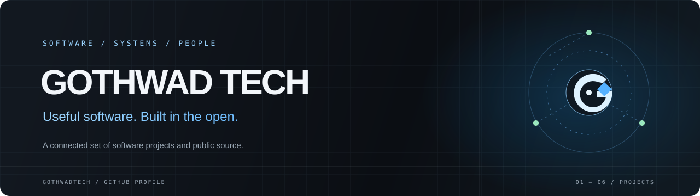

  

  
  
  

  <strong>Gothwad Tech builds a connected set of software products and tools.</strong> 
  Public repositories span web applications, Android projects, identity, communications, and developer documentation.

---

## Start exploring

| Destination | What you'll find |
|:--|:--|
| [**Official website**](https://gothwadtech.com) | The main Gothwad Tech website and product directory. |
| [**Developer docs**](https://docs.gothwadtech.com) | Source-based guides for selected products, setup, APIs, and integrations. Coverage varies by project. |
| [**All repositories**](https://github.com/GothwadTech?tab=repositories) | Browse the public source and project history. |
| [**GitHub Pages showcase**](https://gothwadtech.github.io/) | A concise, visual introduction to selected repositories. |

## A few projects

<table>
  <tr>
    <td width="50%" valign="top">
      <h3>Identity & everyday tools</h3>
      
<a href="https://github.com/GothwadTech/accounts"><strong>Gothwad Accounts</strong></a> — shared identity and sign-in project for Gothwad services.

      
<a href="https://github.com/GothwadTech/mail"><strong>Gothwad Mail</strong></a> — webmail client with a separately documented API and Worker.

      
<a href="https://github.com/GothwadTech/drive"><strong>Gothwad Drive</strong></a> · <a href="https://github.com/GothwadTech/meet"><strong>Meet</strong></a> · <a href="https://github.com/GothwadTech/store"><strong>Store</strong></a>

    </td>
    <td width="50%" valign="top">
      <h3>Communication & devices</h3>
      
<a href="https://github.com/GothwadTech/grixchat"><strong>GrixChat</strong></a> — web messaging project, with a companion <a href="https://github.com/GothwadTech/grixchatapp">Android app</a>.

      
<a href="https://github.com/GothwadTech/browser"><strong>Gothwad Browser</strong></a> — Android browser project for phones and TV devices.

      
<a href="https://github.com/GothwadTech/education"><strong>Gothwad Education</strong></a> — school management and learning platform project.

    </td>
  </tr>
  <tr>
    <td valign="top">
      <h3>Developer tools & docs</h3>
      
<a href="https://github.com/GothwadTech/ai"><strong>Gothwad AI Studio</strong></a> — a GitHub-connected developer workspace.

      
<a href="https://github.com/GothwadTech/plusgit"><strong>PlusGit</strong></a> — Git client project.

      
<a href="https://github.com/GothwadTech/docs"><strong>Gothwad Docs</strong></a> — central, source-based documentation portal.

    </td>
    <td valign="top">
      <h3>See the work in context</h3>
      
Each repository has its own scope, maturity, license, and setup. Check its README and linked documentation for the current details.

      
<a href="https://github.com/GothwadTech?tab=repositories"><strong>Browse every public repository →</strong></a>

    </td>
  </tr>
</table>

## How we describe the work

- **Source before slogans.** Repository documentation is the reference for implementation details.
- **Clear scope.** A public repository is not automatically a released, production-ready, or supported product.
- **No borrowed metrics.** Performance, privacy, security, customer, and availability claims belong only where they are independently documented and current.
- **Different projects, different stacks.** Explore the code to see the technologies and architecture behind each one.

## Contributing and contact

Open an issue in the relevant public repository for a bug report or project-specific discussion. For general company information, use the [official website](https://gothwadtech.com). Please check each repository's license and contribution guidance before reusing code.

---

  This showcase is a curated starting point, not a live service-status page. Project details can change; linked source repositories and docs take precedence.

